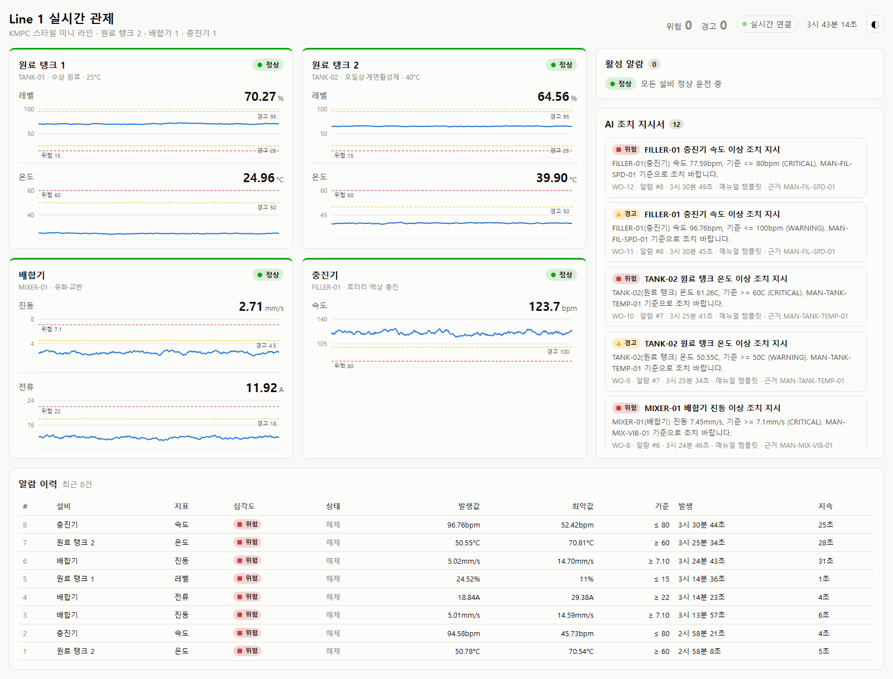
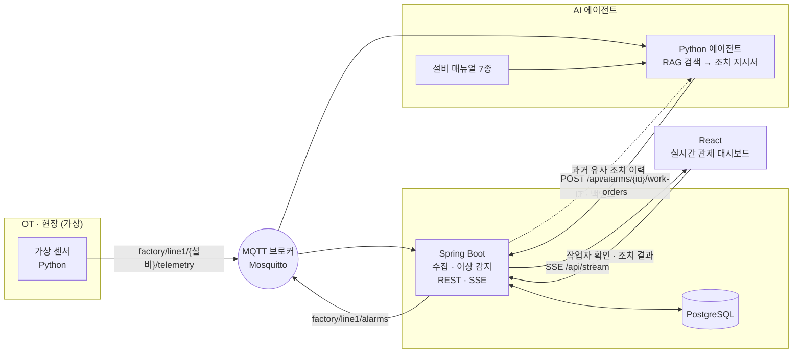
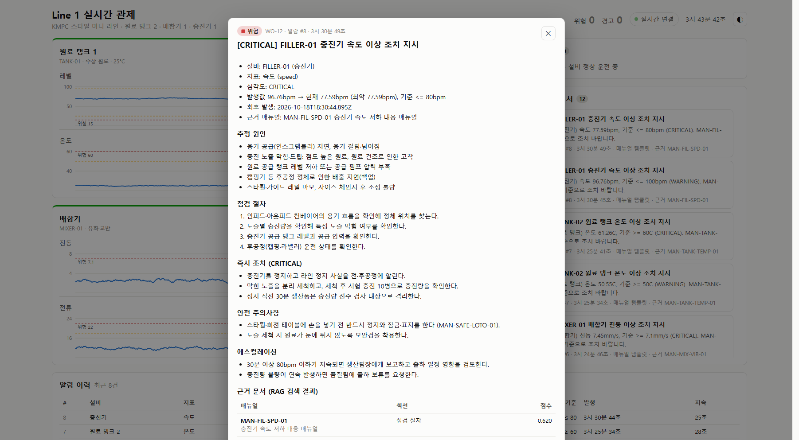

# Factory Agent Demo — 피지컬 AI 관제 데모

화장품·세제 공장의 미니 생산 라인을 가상으로 만들고, **현장 데이터(OT) → IT 시스템 → AI 에이전트**까지 한 흐름으로 연결한 포트폴리오 프로젝트입니다.

센서 값이 MQTT로 들어오면 Spring Boot가 저장하고 이상을 감지합니다. 알람이 발생하면 AI 에이전트가 설비 매뉴얼을 검색(RAG)해 **조치 지시서**를 작성하고, React 대시보드에 실시간으로 표시됩니다.

> 설비·매뉴얼·수치는 모두 데모용 가상 데이터입니다.



*설비 4대의 최근 5분 추세(점선은 경고·위험 기준), AI 조치 지시서 목록, 알람 이력. 서버가 SSE로 밀어주는 값이라 새로고침 없이 갱신됩니다.*

## 데모 라인 구성

| 설비 | ID | 지표 | 정상 운전 | 경고 / 위험 기준 |
|---|---|---|---|---|
| 원료 탱크 1 (수상) | TANK-01 | 레벨, 온도 | 70%, 25°C | 레벨 ≤25 / ≤15%, 온도 ≥50 / ≥60°C |
| 원료 탱크 2 (오일상·계면활성제) | TANK-02 | 레벨, 온도 | 65%, 40°C | 위와 같음 |
| 배합기 | MIXER-01 | 진동, 전류 | 2.5mm/s, 12A | 진동 ≥4.5 / ≥7.1mm/s (ISO 10816 참고), 전류 ≥18 / ≥22A |
| 충진기 | FILLER-01 | 속도 | 120bpm | ≤100 / ≤80bpm |

## 구성도



### 이상 하나가 처리되는 흐름

1. **센서** — 배합기 진동이 오르기 시작한다 (1초마다 MQTT 발행).
2. **수집** — Spring Boot가 구독해 측정값을 `sensor_reading` 테이블에 저장한다.
3. **이상 감지** — 4.5mm/s를 넘으면 경고 알람 발생, 7.1mm/s를 넘으면 같은 알람이 위험으로 상승. 정상 범위로 5% 이상 돌아와야 해제된다 (경계 부근 깜빡임 방지).
4. **알람 발행** — DB 커밋이 끝난 뒤 `factory/line1/alarms`로 알람 이벤트를 발행한다.
5. **AI 에이전트** — 알람을 받아 "배합기 진동 상승 베어링 …" 질의로 매뉴얼을 검색하고, 가장 관련 높은 매뉴얼에서 원인·점검 절차·심각도별 조치·안전·에스컬레이션을 골라 지시서를 만든다.
6. **저장 · 표시** — 지시서를 백엔드에 저장하면 대시보드에 SSE로 바로 나타난다. 근거가 된 매뉴얼 구절과 검색 점수도 함께 남는다.
7. **작업자 피드백** — 작업자가 대시보드에서 지시서를 **확인**하고, 점검이 끝나면 확인한 원인 · 조치 내용 · 결과(해결/부분 해결/미해결)를 입력한다. 원인은 근거 매뉴얼의 "가능 원인"에서 고르고(없으면 기타에 직접 입력), 같은 이름으로 저장돼 통계에서 흩어지지 않는다. 한 알람에서 경고 · 위험 지시서가 따로 나왔어도 하나만 완료하면 나머지는 "함께 처리"로 닫힌다.
8. **다음 지시서에 반영** — 같은 설비 · 지표에 다시 이상이 생기면 에이전트가 완료된 조치 기록을 조회해 지시서 앞쪽에 **과거 유사 조치 이력**을 넣는다. 지난번에 해결된 원인은 "우선 확인"으로 강조한다. 같은 유형의 다른 설비(TANK-01 ↔ TANK-02) 기록도 따로 묶어 "참고"로 보여 준다.
9. **조치 이력 요약** — 대시보드 하단 표에 설비 · 지표별 이상 횟수, 해결률, 평균 처리 시간, 작업자가 입력한 주요 원인이 쌓인다. 기록이 늘수록 반복 고장 설비와 원인이 드러난다.



*충진기 속도 저하(위험) 알람에 대해 에이전트가 작성한 지시서. 추정 원인 → 점검 절차 → 심각도별 즉시 조치 → 안전 → 에스컬레이션 순서이며, 하단에 근거 매뉴얼 섹션과 검색 점수가 남는다.*

## 기술 스택

| 영역 | 사용 기술 |
|---|---|
| 가상 센서 · AI 에이전트 | Python 3.12, paho-mqtt, scikit-learn (TF-IDF), Anthropic SDK (Claude, 선택) |
| 메시징 | Eclipse Mosquitto (MQTT 3.1.1) |
| 백엔드 | Java 17, Spring Boot 3.5, Spring Integration MQTT, Spring Data JPA |
| DB | PostgreSQL 18 (지시서 근거 문서는 `jsonb`), Flyway 마이그레이션 |
| 대시보드 | React 18, TypeScript, Vite, Recharts, SSE(EventSource) |

## 폴더 구조

```
factory-agent-demo/
├── python/
│   ├── sensors/virtual_sensors.py   # 가상 센서 + 이상 시나리오 주입
│   └── agent/
│       ├── agent.py                 # 알람 구독 → 지시서 작성 → 백엔드 저장
│       ├── rag.py                   # 매뉴얼 청킹 · TF-IDF 검색
│       ├── work_order.py            # 템플릿 지시서 생성기 (키가 없거나 LLM 실패 시)
│       ├── llm.py                   # Claude 지시서 생성기 (근거 번호 인용 · 검증)
│       └── manuals/*.md             # 가상 설비 매뉴얼 7종
├── backend/                         # Spring Boot
│   └── src/main/java/com/factoryagent/backend/
│       ├── mqtt/                    # MQTT 구독(텔레메트리) · 발행(알람)
│       ├── telemetry/               # 측정값 저장 · 조회
│       ├── alarm/                   # 임계값 규칙 · 알람 발생/상승/해제
│       ├── workorder/               # 조치 지시서 저장 · 조회 · 작업자 확인 · 조치 결과
│       └── stream/                  # 대시보드용 SSE
├── dashboard/                       # React 관제 화면
├── scripts/                         # 데모 실행 · 이상 주입 · 종료
└── docs/DEMO.md                     # 데모 시나리오
```

## 실행 방법 (Windows 기준)

### 1. 사전 준비 (한 번만)

```powershell
winget install Python.Python.3.12
winget install EclipseFoundation.Mosquitto     # 설치 후 Windows 서비스로 자동 실행
```

Java 17, PostgreSQL, Node.js 20 이상도 필요합니다. 백엔드 빌드는 IntelliJ에 포함된 Maven을 쓰거나 직접 설치한 `mvn`을 씁니다.

**DB 생성** (postgres 관리자 계정으로 1회)

```powershell
psql -h localhost -U postgres -v db_password=<비밀번호> -f backend/db/init.sql
```

테이블은 백엔드가 처음 뜰 때 Flyway가 만듭니다 (`backend/src/main/resources/db/migration`). Flyway 도입 전에 만든 DB는 V1을 기준선으로 등록하고 V2부터 적용합니다.

**DB 비밀번호 설정** — `backend/src/main/resources/application-local.example.yml`을 `application-local.yml`로 복사하고 위 비밀번호를 넣습니다. 이 파일은 git에 올라가지 않습니다. 환경변수 `DB_PASSWORD`로 지정해도 됩니다.

**Python 가상환경**

```powershell
cd python
py -3.12 -m venv .venv
.venv\Scripts\python -m pip install -r requirements.txt
```

**Claude 지시서 (선택)** — `python/.env.example`을 `python/.env`로 복사하고 `ANTHROPIC_API_KEY=`에 Claude API 키를 넣습니다. 이 파일은 git에 올라가지 않습니다. 키가 없으면 매뉴얼 템플릿 지시서로 동작합니다. 모델 · 노력 수준은 같은 파일의 `ANTHROPIC_MODEL` · `ANTHROPIC_EFFORT`로 바꿀 수 있습니다 (기본 `claude-opus-5-5` · `medium`).

### 2. 한 번에 실행

```powershell
powershell -ExecutionPolicy Bypass -File scripts\start-demo.ps1
```

백엔드 → AI 에이전트 → 센서 → 대시보드가 각각 창으로 뜹니다 (작업 표시줄에 최소화, 화면에 띄우려면 `-Visible`). 브라우저에서 **http://localhost:5173** 을 엽니다.

백엔드를 IntelliJ에서 직접 실행하며 개발할 때는 나머지만 띄웁니다.

```powershell
powershell -ExecutionPolicy Bypass -File scripts\start-demo.ps1 -SkipBackend
```

### 3. 이상 주입

```powershell
powershell -File scripts\inject.ps1 mixer_vibration
```

| 시나리오 | 내용 | 찾아야 할 매뉴얼 |
|---|---|---|
| `tank_overheat` | TANK-02 온도 상승 | MAN-TANK-TEMP-01 |
| `tank_low_level` | TANK-01 레벨 저하 | MAN-TANK-LVL-01 |
| `mixer_vibration` | 배합기 진동 상승 | MAN-MIX-VIB-01 |
| `mixer_overcurrent` | 배합기 모터 과전류 | MAN-MIX-CUR-01 |
| `filler_slowdown` | 충진기 속도 저하 | MAN-FIL-SPD-01 |
| `random` | 위 중 하나 | |

### 4. 종료

```powershell
powershell -File scripts\stop-demo.ps1
```

### 각각 따로 실행하기

```powershell
java -jar backend\target\backend-0.0.1-SNAPSHOT.jar          # 백엔드 :8080
cd python; .venv\Scripts\python -m agent.agent                # AI 에이전트
.venv\Scripts\python sensors\virtual_sensors.py               # 가상 센서
cd dashboard; npm install; npm run dev                        # 대시보드 :5173
```

에이전트는 검색만 따로 시험해 볼 수 있습니다.

```powershell
.venv\Scripts\python -m agent.agent --search "배합기 진동이 계속 올라가요"
.venv\Scripts\python -m agent.agent --alarm-id 3 --dry-run    # 저장하지 않고 지시서 미리보기
```

### 테스트

```powershell
mvn -f backend\pom.xml test                                   # 임계값 · 지시서 상태 전이 · 함께 닫기 · 통계 집계
cd python; .venv\Scripts\python -m unittest discover -s tests -t .   # 매뉴얼 검색 · 과거 이력 섹션
```

## MQTT 토픽

| 토픽 | 방향 | 내용 |
|---|---|---|
| `factory/line1/{설비ID}/telemetry` | 센서 → 백엔드 | `{"equipmentId","type","ts","metrics":{...},"units":{...}}` |
| `factory/line1/alarms` | 백엔드 → 에이전트 | `{"event":"RAISED"\|"ESCALATED"\|"CLEARED","alarm":{...}}` |
| `factory/line1/sim/anomaly` | 데모 조작 → 센서 | 시나리오 이름 (예: `mixer_vibration`) |

## REST API

| 메서드 · 경로 | 설명 |
|---|---|
| `GET /api/readings/latest` | 설비·지표별 최신값 |
| `GET /api/readings/history?minutes=5` | 최근 N분 측정값 (최대 60분) |
| `GET /api/alarms?status=ACTIVE` | 알람 목록 (status 생략 시 최근 50건) |
| `GET /api/alarms/{id}` | 알람 1건 |
| `GET /api/alarm-rules` | 임계값 규칙 |
| `POST /api/alarms/{id}/work-orders` | 조치 지시서 저장 (에이전트가 호출) |
| `GET /api/alarms/{id}/work-orders` | 알람별 지시서 |
| `GET /api/work-orders` | 최근 지시서 50건 |
| `POST /api/work-orders/{id}/acknowledge` | 작업자 지시서 확인 `{"worker"}` |
| `POST /api/work-orders/{id}/complete` | 조치 완료 · 결과 입력 `{"worker","rootCause","actionTaken","outcome"}` |
| `GET /api/work-orders/history?equipmentId=&metric=&equipmentType=` | 같은 설비 · 지표의 완료된 조치 최근 5건 + 같은 유형 다른 설비 3건 (에이전트가 호출) |
| `GET /api/action-stats` | 설비 · 지표별 이상 횟수, 조치 완료 · 해결률, 평균 처리 시간, 주요 원인 |
| `GET /api/stream` | SSE: `readings` · `alarm` · `work-order` · `ping` |

## 설계 포인트

- **OT/IT 경계를 MQTT로 분리** — 센서는 백엔드를 모르고 토픽에만 발행합니다. 실제 설비로 바꿀 때 PLC/OPC UA 게이트웨이가 같은 토픽에 발행하면 나머지는 그대로입니다.
- **알람은 상태를 가진 객체** — 설비·지표마다 활성 알람은 하나뿐이고, 같은 알람 안에서 경고 → 위험 상승, 최악값 누적, 히스테리시스 해제를 처리합니다. 알람이 쏟아지지 않게 하기 위해서입니다.
- **커밋 후 이벤트** — 알람 발행과 대시보드 전송은 `@TransactionalEventListener(AFTER_COMMIT)`로 DB 커밋 뒤에 합니다. 에이전트가 지시서를 저장할 때 알람 행이 반드시 있도록 보장합니다.
- **설명 가능한 RAG** — 매뉴얼을 섹션 단위로 쪼개 문자 n-gram TF-IDF로 검색하고, 설비 유형·지표가 맞으면 가점을 줍니다. 지시서마다 근거 섹션과 점수를 남겨 "왜 이 조치인가"를 추적할 수 있습니다. 한국어 형태소 분석이나 모델 다운로드 없이 동작합니다.
- **사람이 최종 판단** — 에이전트는 설비를 직접 조작하지 않고 지시서만 작성합니다. 작업자가 지시서를 확인하고 조치 결과를 남기는 단계를 화면에 두었습니다.
- **현장 경험이 쌓이는 구조** — 작업자가 입력한 원인 · 조치 · 결과가 다음 지시서의 근거가 됩니다. 매뉴얼에는 없는 "이 설비는 보통 이게 원인이었다"는 현장 지식이 매뉴얼 절차 옆에 붙습니다. 지금은 같은 설비 · 지표로 찾고, 이력이 많아지면 증상 유사도로 검색하는 방향으로 넓힐 수 있습니다.
- **근거를 강제한 LLM** — 키가 있으면 Claude가 지시서 문장을 씁니다. 검색은 그대로 TF-IDF가 하고, Claude에는 매뉴얼 구절(S1, S2…)과 과거 조치(H1…)에 번호를 붙여 보냅니다. 응답은 JSON 스키마로 고정하고 모든 항목에 근거 번호를 달게 한 뒤, 근거가 없거나 목록에 없는 번호를 쓰면 그 지시서를 버리고 템플릿으로 씁니다. 지시서에는 항목마다 *(근거: 점검 절차)* 처럼 출처가 붙습니다.
- **LLM이 없어도 동작** — 생성기는 `generate(alarm, index, history)` 인터페이스 하나입니다. 키가 없거나, 크레딧 · 네트워크 오류가 나거나, 근거 검증에 실패하면 매뉴얼 템플릿 생성기가 같은 형식으로 씁니다. 데모는 오프라인에서도 끝까지 돕니다.

## 다음 단계

- [x] LLM 생성기 추가 (검색 근거를 인용하는 형태로, 템플릿은 폴백으로 유지)
- [ ] 임베딩 검색 + pgvector로 전환, 매뉴얼 버전 관리
- [x] 작업자 지시서 확인 · 조치 결과 입력 → 다음 지시서에 과거 유사 조치 이력 반영
- [x] 조치 이력 요약 (설비 · 지표별 이상 횟수 · 해결률 · 평균 처리 시간 · 주요 원인)
- [x] 원인 선택지(매뉴얼 '가능 원인'), 같은 유형 다른 설비 이력 포함
- [ ] 조치 이력을 증상 유사도로 검색, 설비별 MTBF · 원인 추세
- [ ] 다변량 이상 감지 (진동 + 전류 + 온도 상관관계), 추세 기반 조기 경보
- [ ] OPC UA · Modbus 게이트웨이 연동, Docker Compose 배포
