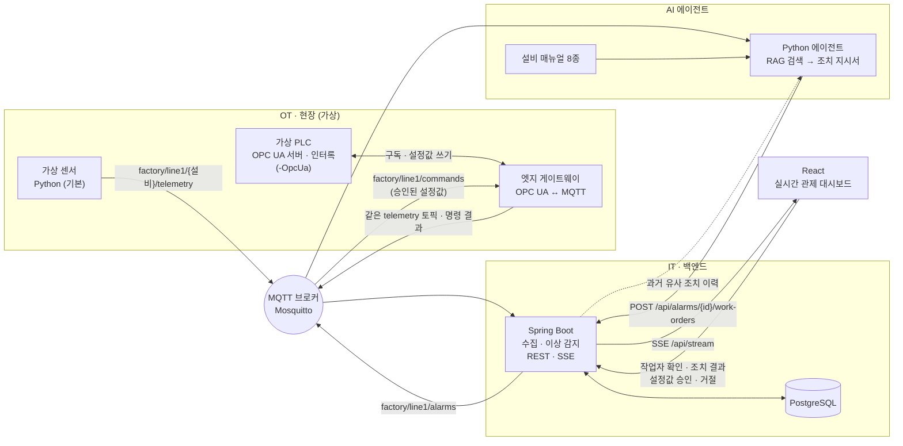

# Factory Agent Demo — 피지컬 AI 관제 데모

화장품·세제 공장의 미니 생산 라인을 가상으로 만들고, **현장 데이터(OT) → IT 시스템 → AI 에이전트**까지 한 흐름으로 연결한 포트폴리오 프로젝트입니다.

센서 값이 MQTT로 들어오면 Spring Boot가 저장하고 이상을 감지합니다. 알람이 발생하면 AI 에이전트가 설비 매뉴얼을 검색(RAG)해 **조치 지시서**를 작성하고, React 대시보드에 실시간으로 표시됩니다.

> 설비·매뉴얼·수치는 모두 데모용 가상 데이터입니다.


*설비 4대의 최근 5분 추세(점선은 경고·위험 기준), AI 조치 지시서 목록, 알람 이력. 서버가 SSE로 밀어주는 값이라 새로고침 없이 갱신됩니다.*

## 데모 라인 구성

| 설비 | ID | 지표 | 정상 운전 | 경고 / 위험 기준 |
|---|---|---|---|---|
| 원료 탱크 1 (수상) | TANK-01 | 레벨, 온도 | 70%, 25°C | 레벨 ≤25 / ≤15%, 온도 ≥50 / ≥60°C |
| 원료 탱크 2 (오일상·계면활성제) | TANK-02 | 레벨, 온도 | 65%, 40°C | 위와 같음 |
| 배합기 | MIXER-01 | 진동, 전류 (+ 내용물 온도: OPC UA 모드) | 2.5mm/s, 12A | 진동 ≥4.5 / ≥7.1mm/s (ISO 10816 참고), 전류 ≥18 / ≥22A, 온도는 배치 단계별 (아래) |
| 충진기 | FILLER-01 | 속도 | 120bpm | ≤100 / ≤80bpm |

## 구성도



데이터 소스는 두 가지입니다. 기본은 **가상 센서**가 MQTT에 바로 발행하고, `-OpcUa`로 띄우면 **가상 PLC(OPC UA 서버) → 엣지 게이트웨이 → MQTT** 경로가 같은 토픽·형식으로 발행합니다. 백엔드는 어느 쪽인지 모릅니다. 설정값 승인(폐루프 제어)은 PLC 경로에서만 동작합니다.

### 이상 하나가 처리되는 흐름

1. **센서** — 배합기 진동이 오르기 시작한다 (1초마다 MQTT 발행).
2. **수집** — Spring Boot가 구독해 측정값을 `sensor_reading` 테이블에 저장한다.
3. **이상 감지** — 4.5mm/s를 넘으면 경고 알람 발생, 7.1mm/s를 넘으면 같은 알람이 위험으로 상승. 정상 범위로 5% 이상 돌아와야 해제된다 (경계 부근 깜빡임 방지).
4. **알람 발행** — DB 커밋이 끝난 뒤 `factory/line1/alarms`로 알람 이벤트를 발행한다.
5. **AI 에이전트** — 알람을 받아 "배합기 진동 상승 베어링 …" 질의로 매뉴얼을 검색하고, 가장 관련 높은 매뉴얼에서 원인·점검 절차·심각도별 조치·안전·에스컬레이션을 골라 지시서를 만든다.
6. **저장 · 표시** — 지시서를 백엔드에 저장하면 대시보드에 SSE로 바로 나타난다. 근거가 된 매뉴얼 구절과 검색 점수도 함께 남는다.
7. **작업자 피드백** — 작업자가 대시보드에서 지시서를 **확인**하고, 점검이 끝나면 확인한 원인 · 조치 내용 · 결과(해결/부분 해결/미해결)를 입력한다. 원인은 근거 매뉴얼의 "가능 원인"에서 고르고(없으면 기타에 직접 입력), 같은 이름으로 저장돼 통계에서 흩어지지 않는다. 한 알람에서 경고 · 위험 지시서가 따로 나왔어도 하나만 완료하면 나머지는 "함께 처리"로 닫힌다.
8. **다음 지시서에 반영** — 같은 설비 · 지표에 다시 이상이 생기면 에이전트가 완료된 조치 기록을 조회해 지시서 앞쪽에 **과거 유사 조치 이력**을 넣는다. 지난번에 해결된 원인은 "우선 확인"으로 강조한다. 같은 유형의 다른 설비(TANK-01 ↔ TANK-02) 기록도 따로 묶어 "참고"로 보여 준다.
9. **조치 이력 요약** — 대시보드 하단 표에 설비 · 지표별 이상 횟수, 해결률, 평균 처리 시간, 작업자가 입력한 주요 원인이 쌓인다. 기록이 늘수록 반복 고장 설비와 원인이 드러난다.
10. **교대 인수인계 리포트** — 상단 **교대 인수인계** 버튼으로 최근 1 · 8 · 24시간 리포트를 요청하면, 에이전트가 그 시간대 알람 · 조치를 읽어 요약 → 주요 이상과 조치 → 다음 교대가 이어서 할 일 → 주의해서 볼 설비 순으로 쓴다. 집계 숫자는 코드가 세고, Claude는 알람 · 지시서 번호를 근거로 문장만 쓴다 (번호 검증 실패 시 템플릿).
11. **추세 기반 조기 경보** — 기준을 넘기 전에, 최근 40초 측정값의 기울기로 "약 N초 뒤 경고 기준 도달"을 예측해 ◆ 예측으로 알린다. 신호마다 평소 수준과 흔들림(σ)을 배워 두고, 평소에서 4σ 이상 · 기준까지 거리의 25% 이상 벗어난 직선 추세만 잡는다 (정상 노이즈 3시간 20분 시뮬레이션에서 오경보 0건). 실제 알람으로 이어지면 "발생 N초 전에 예측됨"이 알람 기록에 남는다. 데모는 `mixer_bearing_wear`(천천히 오르는 진동)로 20~30초 먼저 알린다.
12. **AI에게 질문** — 상단 버튼에서 "배합기 진동 원인이 주로 뭐였어?" 같은 질문을 하면, 에이전트가 최근 7일 알람 · 조치 기록, 설비별 통계, 매뉴얼을 번호 붙여 Claude에 주고 근거 번호가 달린 답을 받는다. 재료로 답할 수 없는 질문은 "답할 수 없다"고 답한다.
13. **매뉴얼 개선 제안** — 조치 이력 요약 표의 **매뉴얼 개선 제안**을 누르면, 그 설비 · 지표의 조치 기록을 매뉴얼과 비교해 개선안 초안을 쓴다. 모든 변경 제안은 현장 조치 기록 근거가 있어야 하고, 고칠 섹션은 실제 매뉴얼 섹션 중에서만 고른다. 사람이 검토해 반영하는 초안이다.
14. **승인형 설정값 제어** (`-OpcUa`) — 매뉴얼의 현재 심각도 조치에 설정값 조정이 있으면(예: 배합기 경고 "교반 회전수를 10~20% 낮추고") 지시서에 **권장 설정값 변경**(태그, 현재값 → 제안값, 이유, 근거)이 붙는다. 작업자가 지시서 팝업에서 **승인 후 실행**을 누르면 백엔드가 운전 범위를 다시 검사하고 감사 기록(승인자, 전후 값, 시각)을 남긴 뒤 `factory/line1/commands`로 명령을 보낸다. 게이트웨이가 PLC 설정값 태그에 OPC UA로 쓰고, PLC 인터록이 받아들이면 공정이 반응한다(회전수 ↓ → 진동 ↓ → 알람 해제). 인터록이 거부하면 그 사유가 화면에 남는다.
15. **배치 단계 인식 알람** (`-OpcUa`) — 가상 PLC가 배합기를 배치 용기로 보고 레시피 단계(원료 투입 → 가열 → 유화 → 냉각 → 배출)를 돌리며 단계 · 배치 번호 · 레시피를 상태 태그로 내보낸다. 백엔드는 단계별 기준으로 판정한다: 같은 75°C라도 유화 중이면 정상, 대기 중이면 위험이고, 유화 중 68°C 아래는 '유화 온도 부족'이다. 단계를 모르면 상온 기준이라 가열할 때마다 오경보가 난다. 단계가 바뀐 직후 10초는 새 알람을 내지 않고, 값이 목표를 향해 움직이는 단계(가열 · 냉각)는 추세 예측을 끈다. 알람과 지시서에 "배치 B-1020-01 · 유화 단계 중 발생"이 남는다.
16. **알람 지속 조건 · 일시 억제** — 규칙마다 "N초 이상 지속돼야 알람"(`delay`)을 둘 수 있다 (배합기 온도 5초, 충진 속도 3초). 정비 중인 설비는 카드의 **알람 억제**로 사유와 함께 30분 동안 새 알람을 끄고, 시간이 지나면 저절로 풀린다 (알람 합리화 표준 ISA-18.2의 shelving).
17. **간이 전자 배치 기록** — 배치마다 단계별 시작 · 소요 시간 · 온도 범위를 남기고, 배치 중 알람 · AI 지시서 · 작업자 조치 · 설정값 변경과 승인자를 한 장으로 묶는다. 판정 요약은 이상 없음 / 이상 있었고 조치 완료(품질 검토) / 조치 미완료(출하 보류 권고)다. CGMP 공장은 무인화해도 배치 기록 의무가 그대로라, AI 판단과 사람 승인이 기록에 함께 남아야 한다.


*충진기 속도 저하(위험) 알람에 대해 에이전트가 작성한 지시서. 추정 원인 → 점검 절차 → 심각도별 즉시 조치 → 안전 → 에스컬레이션 순서이며, 하단에 근거 매뉴얼 섹션과 검색 점수가 남는다.*

## 기술 스택

| 영역 | 사용 기술 |
|---|---|
| 가상 센서 · AI 에이전트 | Python 3.12, paho-mqtt, scikit-learn (TF-IDF), Anthropic SDK (Claude, 선택) |
| 가상 PLC · 엣지 게이트웨이 | Python asyncua (OPC UA 서버 · 클라이언트, 구독 · 쓰기) |
| 메시징 | Eclipse Mosquitto (MQTT 3.1.1) |
| 백엔드 | Java 17, Spring Boot 3.5, Spring Integration MQTT, Spring Data JPA |
| DB | PostgreSQL 18 (지시서 근거 문서는 `jsonb`), Flyway 마이그레이션 |
| 대시보드 | React 18, TypeScript, Vite, Recharts, SSE(EventSource) |

## 폴더 구조

```
factory-agent-demo/
├── python/
│   ├── sensors/virtual_sensors.py   # 가상 센서 + 이상 시나리오 주입
│   ├── plc/
│   │   ├── process.py               # 공정 모델(설정값 반영) + 인터록 (OPC UA 무관 순수 로직)
│   │   ├── virtual_plc.py           # 가상 PLC: OPC UA 서버로 태그 노출, 설정값 쓰기 검사
│   │   ├── edge_gateway.py          # OPC UA 구독 → MQTT 텔레메트리, MQTT 명령 → OPC UA 쓰기
│   │   └── direct_write.py          # 승인 없이 게이트웨이에 직접 명령 (인터록 시연용)
│   └── agent/
│       ├── agent.py                 # 알람 구독 → 지시서 작성 → 백엔드 저장
│       ├── rag.py                   # 매뉴얼 청킹 · TF-IDF 검색
│       ├── work_order.py            # 템플릿 지시서 생성기 (키가 없거나 LLM 실패 시)
│       ├── llm.py                   # Claude 지시서 생성기 (근거 번호 인용 · 검증)
│       ├── handover.py              # 교대 인수인계 리포트 (Claude · 템플릿)
│       ├── assistant.py             # AI 질문 답변 · 매뉴얼 개선 제안 (Claude · 템플릿)
│       ├── setpoint.py              # 권장 설정값 변경 (템플릿 규칙 · LLM 제안 검증)
│       └── manuals/*.md             # 가상 설비 매뉴얼 8종
├── backend/                         # Spring Boot
│   └── src/main/java/com/factoryagent/backend/
│       ├── mqtt/                    # MQTT 구독(텔레메트리) · 발행(알람)
│       ├── telemetry/               # 측정값 저장 · 조회
│       ├── alarm/                   # 임계값 규칙 · 알람 발생/상승/해제
│       ├── workorder/               # 조치 지시서 저장 · 조회 · 작업자 확인 · 조치 결과
│       ├── handover/                # 교대 인수인계 리포트 요청 · 재료 · 결과
│       ├── forecast/                # 추세 기반 조기 경보 (회귀 · 평소 수준 학습)
│       ├── assistant/               # AI 질문 · 매뉴얼 개선 제안 요청 · 재료 · 결과
│       ├── control/                 # 설정값 변경 제안 · 승인 · 거절 · 감사 기록 · 명령 결과
│       ├── batch/                   # 배치 단계 추적 · 배치 기록(EBR) · 단계별 기준 조회
│       └── stream/                  # 대시보드용 SSE
├── dashboard/                       # React 관제 화면
├── scripts/                         # 데모 실행 · 이상 주입 · 종료
└── docs/DEMO.md                     # 데모 시나리오
```

## 실행 방법 (Windows 기준)

### 1. 사전 준비 (한 번만)

```powershell
winget install Python.Python.3.12
winget install EclipseFoundation.Mosquitto     # 설치 후 Windows 서비스로 자동 실행
```

Java 17, PostgreSQL, Node.js 20 이상도 필요합니다. 백엔드 빌드는 IntelliJ에 포함된 Maven을 쓰거나 직접 설치한 `mvn`을 씁니다.

**DB 생성** (postgres 관리자 계정으로 1회)

```powershell
psql -h localhost -U postgres -v db_password=<비밀번호> -f backend/db/init.sql
```

테이블은 백엔드가 처음 뜰 때 Flyway가 만듭니다 (`backend/src/main/resources/db/migration`). Flyway 도입 전에 만든 DB는 V1을 기준선으로 등록하고 V2부터 적용합니다.

**DB 비밀번호 설정** — `backend/src/main/resources/application-local.example.yml`을 `application-local.yml`로 복사하고 위 비밀번호를 넣습니다. 이 파일은 git에 올라가지 않습니다. 환경변수 `DB_PASSWORD`로 지정해도 됩니다.

**Python 가상환경**

```powershell
cd python
py -3.12 -m venv .venv
.venv\Scripts\python -m pip install -r requirements.txt
```

**Claude 지시서 (선택)** — `python/.env.example`을 `python/.env`로 복사하고 `ANTHROPIC_API_KEY=`에 Claude API 키를 넣습니다. 이 파일은 git에 올라가지 않습니다. 키가 없으면 매뉴얼 템플릿 지시서로 동작합니다. 모델 · 노력 수준은 같은 파일의 `ANTHROPIC_MODEL` · `ANTHROPIC_EFFORT`로 바꿀 수 있습니다 (기본 `claude-opus-5-5` · `medium`).

### 2. 한 번에 실행

```powershell
powershell -ExecutionPolicy Bypass -File scripts\start-demo.ps1
```

백엔드 → AI 에이전트 → 센서 → 대시보드가 각각 창으로 뜹니다 (작업 표시줄에 최소화, 화면에 띄우려면 `-Visible`). 브라우저에서 **http://localhost:5173** 을 엽니다.

백엔드를 IntelliJ에서 직접 실행하며 개발할 때는 나머지만 띄웁니다.

```powershell
powershell -ExecutionPolicy Bypass -File scripts\start-demo.ps1 -SkipBackend
```

**OPC UA 모드** — 가상 센서 대신 가상 PLC(OPC UA 서버, `opc.tcp://localhost:4840/factory/line1/`)와 엣지 게이트웨이를 띄웁니다. 설정값 승인 데모는 이 모드에서 합니다. 다른 스위치와 함께 써도 됩니다 (`-OpcUa -Build`).

```powershell
powershell -ExecutionPolicy Bypass -File scripts\start-demo.ps1 -OpcUa
```

UaExpert 같은 OPC UA 클라이언트로 `opc.tcp://localhost:4840/factory/line1/`에 붙으면 아래 태그를 직접 볼 수 있습니다 (보안 없음, 익명 · 데모 전용).

| 태그 (NodeId, ns=2) | 역할 | 내용 |
|---|---|---|
| `Line1.{설비ID}.{지표}` 예) `Line1.MIXER-01.vibration` | PV · 읽기 | 측정값. 1초마다 PLC 스캔으로 갱신 |
| `Line1.MIXER-01.speed` | PV · 읽기 | 실제 교반 회전수(rpm). 설정값을 초당 3rpm 씩 따라감 |
| `Line1.MIXER-01.speed_sp` | SP · 쓰기 | 교반 회전수 설정값. 진동은 회전수 비율의 세제곱, 전류는 부하에 비례 |
| `Line1.TANK-02.temp_sp` | SP · 쓰기 | 탱크 2 온도 설정값. 온도가 이 값으로 수렴 |
| `Line1.{설비ID}.LastInterlock` | 읽기 | 마지막 인터록 거부 사유 |
| `Line1.MIXER-01.temperature` | PV · 읽기 | 배합기 내용물 온도. 배치 단계마다 목표가 바뀜 (가열 · 유화 75°C, 냉각 40°C) |
| `Line1.MIXER-01.batchPhase` · `batchId` · `recipe` | STATE · 읽기 | 배치 단계(IDLE · CHARGING · HEATING · EMULSIFYING · COOLING · DISCHARGING), 배치 번호, 레시피 (문자열) |

설비 객체에는 `EquipmentType`, 태그에는 `Unit` · `Role`(PV/SP) 속성이 있어 게이트웨이는 설정 파일 없이 주소 공간을 browse 해서 태그를 찾습니다.

**설정값의 세 겹 안전장치**

| 단계 | 어디서 | 무엇을 |
|---|---|---|
| 1. AI 제안 검증 | 에이전트 | 근거 번호 · 운전 범위 · 한 번 변경폭. 실패하면 제안 없이 지시서만 |
| 2. 사람 승인 + 운전 범위 | 백엔드 (`app.control`) | 승인 시점의 현재값으로 다시 검사, 감사 기록. 교반 40~66rpm(1회 15), 탱크 2 온도 30~45°C(1회 20) |
| 3. PLC 인터록 | 가상 PLC (`plc/process.py`) | AI · 백엔드와 독립된 마지막 장치. 하드 리밋(교반 30~72rpm, 온도 20~60°C, 1회 20) 밖은 `BadOutOfRange`, 진동 위험(≥7.1) 중 증속 · 온도 경고(≥50°C) 중 설정값 상향은 `BadInvalidState` |

### 3. 이상 주입

```powershell
powershell -File scripts\inject.ps1 mixer_vibration
```

| 시나리오 | 내용 | 찾아야 할 매뉴얼 |
|---|---|---|
| `tank_overheat` | TANK-02 온도 상승 | MAN-TANK-TEMP-01 |
| `tank_low_level` | TANK-01 레벨 저하 | MAN-TANK-LVL-01 |
| `mixer_vibration` | 배합기 진동 상승 | MAN-MIX-VIB-01 |
| `mixer_overcurrent` | 배합기 모터 과전류 | MAN-MIX-CUR-01 |
| `filler_slowdown` | 충진기 속도 저하 | MAN-FIL-SPD-01 |
| `mixer_bearing_wear` | 배합기 진동이 천천히 상승 (약 40초 뒤 경고, 추세 예측 데모용) | MAN-MIX-VIB-01 |
| `mixer_resonance` | 회전수 과다로 인한 공진: 약 15초 뒤 진동 경고(5.6mm/s)에서 10분간 유지. OPC UA 모드에서 회전수 설정값을 낮추면 해소 | MAN-MIX-VIB-01 |
| `tank_sp_misentry` | TANK-02 온도 설정값을 55°C로 잘못 입력 → 약 10초 뒤 온도 경고. 설정값을 40°C로 되돌리면 해소 (OPC UA 모드 전용) | MAN-TANK-TEMP-01 |
| `batch_start` | 배치 1회 시작 (원료 투입 20초 → 가열 45초 → 유화 60초 → 냉각 45초 → 배출 20초). 현장 HMI 시작 버튼 시뮬레이션 (OPC UA 모드 전용) | |
| `mixer_underheat` | 재킷 스팀 공급 저하로 배합기 온도가 최대 18°C 낮아짐. 유화 중이면 '유화 온도 부족' 경고 → 위험, 대기 중이면 알람 아님 (OPC UA 모드 전용) | MAN-MIX-TEMP-01 |
| `random` | 위 중 하나 (`tank_sp_misentry` 제외) | |

**인터록 시연** (OPC UA 모드) — 백엔드 승인을 거치지 않고 게이트웨이에 직접 명령을 보냅니다. PLC가 거부하고, 대시보드 **설정값 변경 이력**에 "외부 명령 · PLC 인터록 거부"로 남습니다.

```powershell
powershell -File scripts\plc-write.ps1 MIXER-01 speed_sp 95     # 허용 범위 밖 → BadOutOfRange
powershell -File scripts\plc-write.ps1 TANK-02 temp_sp 58       # tank_sp_misentry 로 온도 경고 중 상향 → BadInvalidState
```

### 4. 종료

```powershell
powershell -File scripts\stop-demo.ps1
```

### 각각 따로 실행하기

```powershell
java -jar backend\target\backend-0.0.1-SNAPSHOT.jar          # 백엔드 :8080
cd python; .venv\Scripts\python -m agent.agent                # AI 에이전트
.venv\Scripts\python sensors\virtual_sensors.py               # 가상 센서
.venv\Scripts\python -m plc.virtual_plc                       # 또는 가상 PLC (OPC UA :4840)
.venv\Scripts\python -m plc.edge_gateway                      #      + 엣지 게이트웨이
cd dashboard; npm install; npm run dev                        # 대시보드 :5173
```

에이전트는 검색만 따로 시험해 볼 수 있습니다.

```powershell
.venv\Scripts\python -m agent.agent --search "배합기 진동이 계속 올라가요"
.venv\Scripts\python -m agent.agent --alarm-id 3 --dry-run    # 저장하지 않고 지시서 미리보기
```

### 테스트

```powershell
mvn -f backend\pom.xml test                                   # 임계값 · 단계별 알람 · 지속 조건 · 억제 · 배치 기록 · 지시서 · 설정값 승인
cd python; .venv\Scripts\python -m unittest discover -s tests -t .   # 매뉴얼 검색 · LLM 검증 · 설정값 제안 · PLC 인터록 · OPC UA 왕복
```

## MQTT 토픽

| 토픽 | 방향 | 내용 |
|---|---|---|
| `factory/line1/{설비ID}/telemetry` | 센서 또는 게이트웨이 → 백엔드 | `{"equipmentId","type","ts","metrics":{...},"units":{...}}` (게이트웨이는 `speed` · `*_sp` · 배합기 `temperature` 와 `"state":{"batchPhase","batchId","recipe"}` 도 함께) |
| `factory/line1/commands` | 백엔드 → 게이트웨이 | `{"requestId","equipmentId","tag","value","approvedBy"}` 승인된 설정값 |
| `factory/line1/commands/results` | 게이트웨이 → 백엔드 | `{"requestId","status":"APPLIED"\|"INTERLOCKED"\|"FAILED","code","message","before","after"}` |
| `factory/line1/alarms` | 백엔드 → 에이전트 | `{"event":"RAISED"\|"ESCALATED"\|"CLEARED","alarm":{...}}` |
| `factory/line1/handover/requests` | 백엔드 → 에이전트 | `{"reportId","from","to"}` 인수인계 리포트 작성 요청 |
| `factory/line1/assistant/requests` | 백엔드 → 에이전트 | `{"taskId","type"}` AI 질문 · 매뉴얼 개선 제안 작성 요청 |
| `factory/line1/sim/anomaly` | 데모 조작 → 센서 | 시나리오 이름 (예: `mixer_vibration`) |

## REST API

| 메서드 · 경로 | 설명 |
|---|---|
| `GET /api/readings/latest` | 설비·지표별 최신값 |
| `GET /api/readings/history?minutes=5` | 최근 N분 측정값 (최대 60분) |
| `GET /api/alarms?status=ACTIVE` | 알람 목록 (status 생략 시 최근 50건) |
| `GET /api/alarms/{id}` | 알람 1건 |
| `GET /api/alarm-rules` | 임계값 규칙 |
| `POST /api/alarms/{id}/work-orders` | 조치 지시서 저장 (에이전트가 호출) |
| `GET /api/alarms/{id}/work-orders` | 알람별 지시서 |
| `GET /api/work-orders` | 최근 지시서 50건 |
| `POST /api/work-orders/{id}/acknowledge` | 작업자 지시서 확인 `{"worker"}` |
| `POST /api/work-orders/{id}/complete` | 조치 완료 · 결과 입력 `{"worker","rootCause","actionTaken","outcome"}` |
| `GET /api/work-orders/history?equipmentId=&metric=&equipmentType=` | 같은 설비 · 지표의 완료된 조치 최근 5건 + 같은 유형 다른 설비 3건 (에이전트가 호출) |
| `GET /api/action-stats` | 설비 · 지표별 이상 횟수, 조치 완료 · 해결률, 평균 처리 시간, 주요 원인 |
| `POST /api/handover-reports` | 인수인계 리포트 요청 `{"hours"}` (1~24, 기본 8) → PENDING |
| `GET /api/handover-reports` | 최근 리포트 10건 |
| `GET /api/handover-reports/{id}/context` | 리포트 재료: 시간대 알람 · 지시서 요약 (에이전트가 호출) |
| `POST /api/handover-reports/{id}/result` | 작성된 리포트 저장 → DONE (에이전트가 호출) |
| `GET /api/forecasts` | 진행 중인 추세 예측 경보 |
| `POST /api/assistant/questions` | AI 질문 `{"question"}` (500자 이내) → PENDING |
| `POST /api/assistant/manual-proposals` | 매뉴얼 개선 제안 요청 `{"equipmentId","metric"}` → PENDING |
| `GET /api/assistant/tasks` | 최근 AI 작업 20건 |
| `GET /api/assistant/tasks/{id}/context` · `POST …/result` | 재료 읽기 · 결과 저장 (에이전트가 호출) |
| `GET /api/setpoints?equipmentId=` | 원격 설정값 · 운전 범위 · 현재값 (게이트웨이가 30초 넘게 조용하면 현재값 null, 에이전트가 호출) |
| `POST /api/work-orders/{id}/setpoint-changes` | 권장 설정값 변경 제안 `{"tag","proposedValue","reason","sources","generator"}` (범위 밖이면 422, 에이전트가 호출) |
| `GET /api/setpoint-changes` | 최근 설정값 변경 30건 (제안 · 승인 · 결과 · 외부 명령) |
| `POST /api/setpoint-changes/{id}/approve` · `…/reject` | 승인(명령 전송) · 거절 `{"worker","note"}` |
| `GET /api/setpoint-changes/{id}/audit` | 감사 기록 (제안 → 승인 → 반영/인터록 거부, 누가 · 언제 · 전후 값) |
| `GET /api/batch/state` | 설비별 현재 배치 단계 · 배치 번호 · 단계 시작 시각 |
| `GET /api/alarm-rules/phases` | 설비 유형 → 지표 → 배치 단계 → 임계값 |
| `GET /api/batches` · `GET /api/batches/{id}/record` | 최근 배치 20건 · 배치 기록 한 장 (단계, 배치 중 알람 · 지시서 · 설정값 변경, 판정 요약) |
| `GET /api/alarm-shelves` · `POST /api/alarm-shelves` | 진행 중인 알람 억제 · 억제 시작 `{"equipmentId","metric","minutes","reason","worker"}` (사유 필수, 최대 120분) |
| `POST /api/alarm-shelves/{id}/release` | 억제 해제 `{"worker"}` |
| `GET /api/stream` | SSE: `readings` · `alarm` · `forecast` · `work-order` · `handover` · `assistant` · `setpoint` · `batch` · `shelf` · `ping` |

## 설계 포인트

- **OT/IT 경계를 MQTT로 분리** — 센서는 백엔드를 모르고 토픽에만 발행합니다. 실제로 가상 PLC(OPC UA) + 엣지 게이트웨이로 바꿔 띄워도 백엔드 코드는 그대로입니다. 게이트웨이는 PLC 주소 공간을 browse 해서 태그를 찾고, 구독(subscription)으로 값이 바뀔 때만 받습니다.
- **알람은 상태를 가진 객체** — 설비·지표마다 활성 알람은 하나뿐이고, 같은 알람 안에서 경고 → 위험 상승, 최악값 누적, 히스테리시스 해제를 처리합니다. 알람이 쏟아지지 않게 하기 위해서입니다.
- **커밋 후 이벤트** — 알람 발행과 대시보드 전송은 `@TransactionalEventListener(AFTER_COMMIT)`로 DB 커밋 뒤에 합니다. 에이전트가 지시서를 저장할 때 알람 행이 반드시 있도록 보장합니다.
- **설명 가능한 RAG** — 매뉴얼을 섹션 단위로 쪼개 문자 n-gram TF-IDF로 검색하고, 설비 유형·지표가 맞으면 가점을 줍니다. 지시서마다 근거 섹션과 점수를 남겨 "왜 이 조치인가"를 추적할 수 있습니다. 한국어 형태소 분석이나 모델 다운로드 없이 동작합니다.
- **사람이 최종 판단** — 에이전트는 설비를 직접 조작하지 않고 지시서와 권장 설정값까지만 씁니다. 자율 수준은 "승인 후 실행"입니다: 작업자가 승인해야 명령이 나가고, 승인 · 결과는 감사 기록으로 쌓입니다(수정 · 삭제 없음).
- **알람은 공정 맥락으로 판정한다** — 화장품 · 세제는 배치 공정이라 단계마다 정상 범위가 다릅니다. 고정 임계값 대신 PLC의 배치 단계를 받아 단계별 기준을 쓰고, 단계 전환 직후 유예 · 지속 조건 · 일시 억제로 의미 없는 알람을 줄였습니다 (ISA-18.2 알람 합리화). 단계별 기준은 설정 파일에 있어 레시피가 늘어나면 표만 늘리면 됩니다.
- **안전 인터록은 PLC에 남긴다** — 백엔드의 운전 범위와 별개로 PLC 안에 하드 리밋과 위험 조건 인터록이 있습니다. 백엔드에 버그가 있거나 누가 게이트웨이에 직접 명령을 넣어도 PLC가 거부하고(`BadOutOfRange` · `BadInvalidState`), 그 시도도 기록됩니다. 승인 후 15초 안에 설비 응답이 없으면 실패로 닫습니다.
- **현장 경험이 쌓이는 구조** — 작업자가 입력한 원인 · 조치 · 결과가 다음 지시서의 근거가 됩니다. 매뉴얼에는 없는 "이 설비는 보통 이게 원인이었다"는 현장 지식이 매뉴얼 절차 옆에 붙습니다. 지금은 같은 설비 · 지표로 찾고, 이력이 많아지면 증상 유사도로 검색하는 방향으로 넓힐 수 있습니다.
- **근거를 강제한 LLM** — 키가 있으면 Claude가 지시서 문장을 씁니다. 검색은 그대로 TF-IDF가 하고, Claude에는 매뉴얼 구절(S1, S2…)과 과거 조치(H1…)에 번호를 붙여 보냅니다. 응답은 JSON 스키마로 고정하고 모든 항목에 근거 번호를 달게 한 뒤, 근거가 없거나 목록에 없는 번호를 쓰면 그 지시서를 버리고 템플릿으로 씁니다. 지시서에는 항목마다 *(근거: 점검 절차)* 처럼 출처가 붙습니다.
- **LLM이 없어도 동작** — 생성기는 `generate(alarm, index, history)` 인터페이스 하나입니다. 키가 없거나, 크레딧 · 네트워크 오류가 나거나, 근거 검증에 실패하면 매뉴얼 템플릿 생성기가 같은 형식으로 씁니다. 데모는 오프라인에서도 끝까지 돕니다.

## 다음 단계

- [x] LLM 생성기 추가 (검색 근거를 인용하는 형태로, 템플릿은 폴백으로 유지)
- [ ] 임베딩 검색 + pgvector로 전환, 매뉴얼 버전 관리
- [x] 작업자 지시서 확인 · 조치 결과 입력 → 다음 지시서에 과거 유사 조치 이력 반영
- [x] 조치 이력 요약 (설비 · 지표별 이상 횟수 · 해결률 · 평균 처리 시간 · 주요 원인)
- [x] 원인 선택지(매뉴얼 '가능 원인'), 같은 유형 다른 설비 이력 포함
- [ ] 조치 이력을 증상 유사도로 검색, 설비별 MTBF · 원인 추세
- [x] 추세 기반 조기 경보 (평소 수준 학습 + 회귀 기울기)
- [x] 교대 인수인계 리포트, AI 질문, 매뉴얼 개선 제안
- [ ] 다변량 이상 감지 (진동 + 전류 + 온도 상관관계), 예측 경보 정확도 기록
- [x] OPC UA 가상 PLC · 엣지 게이트웨이, 승인형 설정값 제어 (PLC 인터록)
- [x] 배치 단계 인식 알람, 알람 지속 조건 · 일시 억제, 간이 전자 배치 기록
- [ ] 운전자 HMI 입력 모드, 로그인 · 역할 · 전자서명 승인(21 CFR Part 11), 태블릿 작업자 화면
- [ ] 설비 · 태그 마스터(단계별 기준을 DB와 관리 화면으로), 다변량 이상 감지, MTBF · MTTR · 간이 OEE
- [ ] 증상 유사도 이력 검색 (임베딩과 함께), 폐쇄망용 로컬 LLM
- [ ] OPC UA 보안(서명 · 암호화, 사용자 인증), Modbus, Sparkplug B, Docker Compose 배포
