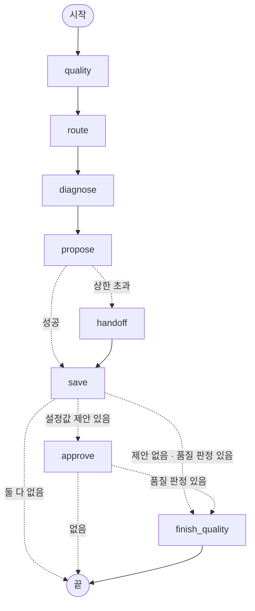

# 알람 오케스트레이터: 직접 구현 vs LangGraph

같은 알람 처리 흐름(라우터 → 진단 → 조치 제안 → 품질 판정 → 승인 요청, 실패하면 사람에게 넘김)을 두 가지로 짜서 비교했다.

- 직접 구현: `python/agent/orchestrator.py` 의 `Orchestrator` (데모가 실제로 쓰는 것)
- LangGraph: `python/agent/orchestrator_graph.py` 의 `build_graph()` (비교용, 데모는 쓰지 않음)

두 구현은 라우터(`classify`), 사람에게 넘기는 지시서(`handoff_order`), 처리 기록(`trace_section`)을 함께 쓰고 **흐름 제어만** 다르다.

## 같은 결과를 내는가

`tests/test_orchestrator_graph.py` 의 동등성 테스트: 평가셋 28문항 × (설정값 없음 / 있음) = 56가지 입력에서 두 구현의 **경로 · 자율성 단계 · 승인 상태 · 결정 로그 · 저장된 지시서 본문 · 설정값 제안 · 품질 판정**이 모두 같다 (배치 진행 중 알람 10문항 포함). 실패 처리(재시도 상한 초과 → handoff, 타임아웃 → handoff)도 같은 결과다.

## 그래프

- `quality`: 품질 에이전트의 **규칙 판정을 맨 앞에서** 하고 바로 저장한다 (배치 진행 중 알람만, 몇 ms). 홀드면 지시서를 기다리지 않고 품질팀 승인 대기가 된다 ("급한 판단 먼저").
- `propose`: 지시서 에이전트 (매뉴얼 근거 지시서, 설정값 제안, LLM 약 10초)
- `finish_quality`: 지시서가 나온 뒤 Claude 가 지시서 요약까지 보고 판정 이유를 쓰고, 판정에 지시서를 연결한다. 판정을 먼저 저장하지 못했으면 여기서 지시서 번호로 저장한다.

품질 판정은 다른 단계의 결과가 필요 없고, 이유 설명만 지시서 요약이 필요하다. 그래서 판정과 설명을 나눠 판정은 맨 앞, 설명은 맨 뒤에 두었다 (실측: 판정이 지시서보다 약 10초 먼저 화면에 뜬다).

LangGraph 는 이 그림을 코드에서 바로 뽑는다 (`graph.get_graph().draw_mermaid()`). 직접 구현은 같은 그림을 문서로 따로 그려야 한다. 이 그림은 2026-11-19 "급한 판단 먼저"로 바꾼 뒤 코드에서 뽑은 엣지에 맞춰 다시 그렸다.

## 비교

| 항목 | 직접 구현 | LangGraph |
|---|---|---|
| 흐름 표현 | `run()` 안의 함수 호출 순서와 `try/except` | 노드 + 엣지 선언, 조건 분기는 `add_conditional_edges` |
| 공유 상태 | 데이터클래스 하나를 단계들이 직접 고침 | `TypedDict`, 노드는 바뀐 필드만 반환. 로그·결정은 리듀서(`operator.add`)로 누적 |
| 재시도 | 단계마다 같은 도우미(`_step`) | 노드에 `RetryPolicy` 선언 (저장 노드에 사용) |
| 재시도 상한 후 사람에게 넘김 | 예외(`StepFailed`)를 잡아 handoff | `RetryPolicy` 는 상한을 넘으면 그래프를 예외로 멈춤 → 넘김이 필요한 노드는 안에서 시도하고 **조건 엣지**로 handoff 노드에 보냄 |
| 단계별 타임아웃 | 도우미에 있음 | 노드별 타임아웃 없음(그래프 전체 `step_timeout` 만) → 같은 도우미를 씀 |
| 사람 승인 대기 | 승인 대기로 저장하고 끝. 승인은 대시보드 → 백엔드가 따로 처리 | `interrupt()` 로 그래프를 멈추고 상태를 체크포인터에 저장, 작업자 결정이 오면 `Command(resume=...)` 로 이어서 끝냄 |
| 흐름 그림 | 문서로 따로 | 코드에서 자동 생성 |
| 의존성 | 없음 (표준 라이브러리) | langgraph + langchain-core · pydantic · ormsgpack 등 10여 개 패키지 |
| 코드 양 (흐름 제어 부분) | 약 250줄 (콘솔 출력 · 결정 로그 파일 포함) | 약 270줄 (파일 전체, 콘솔 출력 · 로그 파일 없음, 직접 구현 부품 재사용) |
| 에이전트 추가 (품질 에이전트) | `run()` 에 단계 하나, 출구에 저장 하나 | 노드 둘 + 조건 엣지 셋. 저장 뒤 갈래가 셋(승인 · 품질 저장 · 끝)으로 늘어 그림으로 보는 이점이 커짐 |

## 판단

- **지금 데모에는 직접 구현을 유지한다.** 흐름이 직선에 분기 두 개뿐이고, 승인 대기는 이미 백엔드(DB의 설정값 변경 상태)가 들고 있어서 그래프 체크포인터가 할 일이 없다. 의존성 10여 개를 더할 이유가 약하다.
- **LangGraph 가 이득이 되는 시점**
  - 흐름이 길어지고 분기·반복이 늘 때 (예: 진단 결과가 부족하면 추가 조회 후 다시 진단하는 루프, 에이전트 여러 개가 순서를 바꿔 가며 일함)
  - 사람 승인을 **흐름 중간에서** 기다렸다가 같은 흐름을 이어 가야 할 때 (승인 후 결과 확인 → 실패하면 다른 제안). 이때 `interrupt` + 체크포인터가 상태 저장 · 재개를 대신해 준다.
  - 처리 과정을 그림과 실행 기록으로 보여 줘야 할 때 (그래프 그림 자동 생성, LangSmith 추적)
- **주의할 점**: 상태에 직접 만든 클래스를 넣으면 체크포인터가 역직렬화 허용 목록을 요구한다 (`checkpoint_serde()`). 재시도 정책은 "상한을 넘으면 실패"가 기본이라, "넘으면 사람에게"는 직접 분기로 만들어야 한다.

## 면접용 한 줄

"오케스트레이터를 먼저 직접 짜서 단일 입구 · 라우터 · 승인 · handoff 를 이해한 뒤, 같은 흐름을 LangGraph 로 다시 짜서 56가지 입력에서 결과가 같은 것을 확인했습니다. 지금 규모에서는 의존성 없는 직접 구현을 쓰고, 흐름 중간에 사람 승인을 기다렸다 이어 가야 할 때 LangGraph 의 interrupt · 체크포인터를 쓰는 게 맞다고 판단했습니다."
